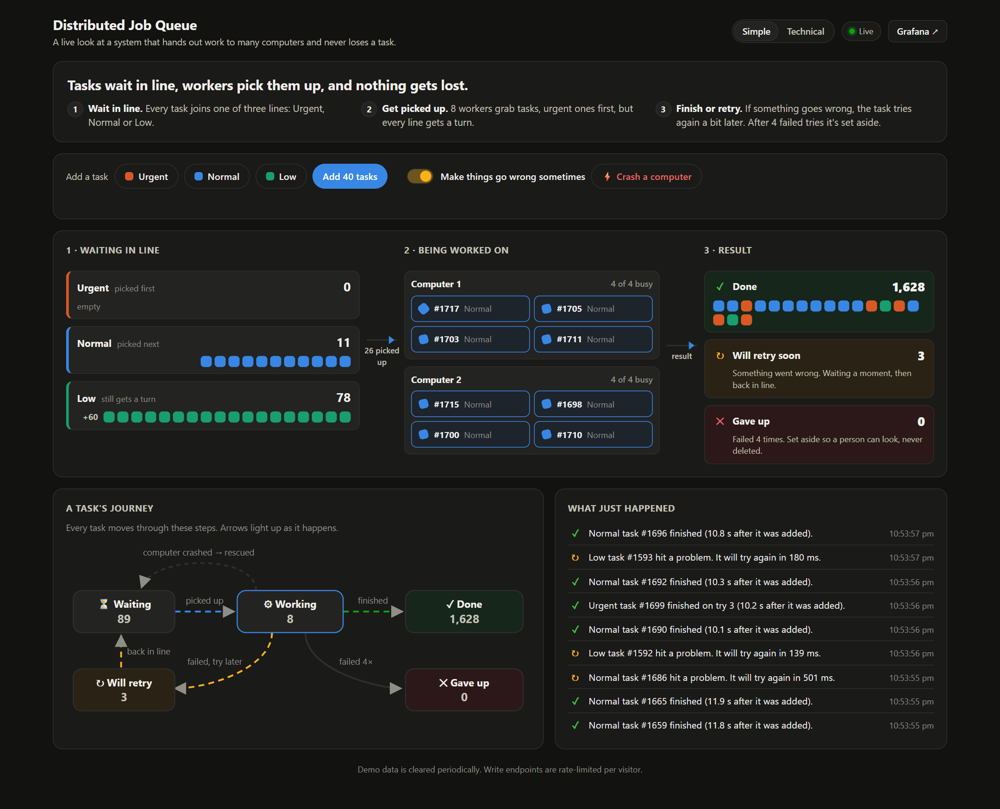
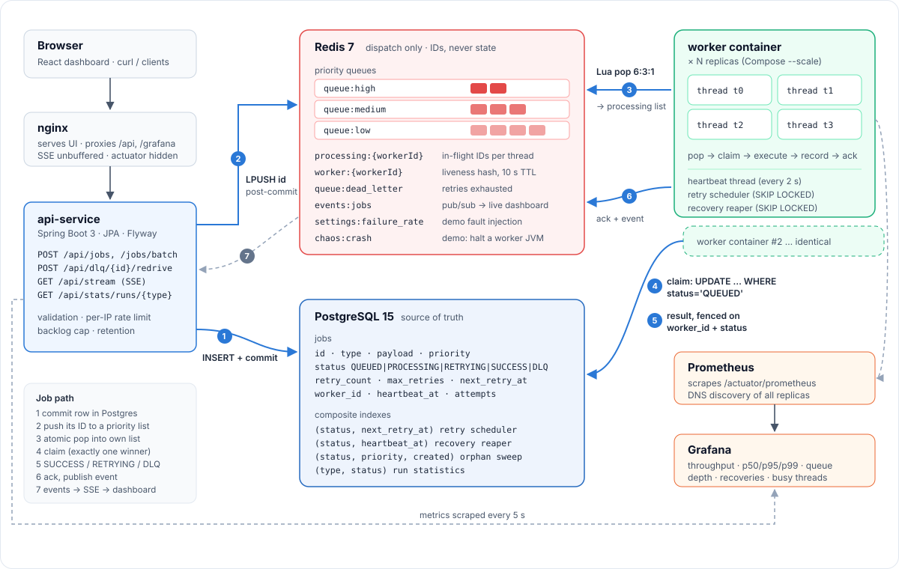
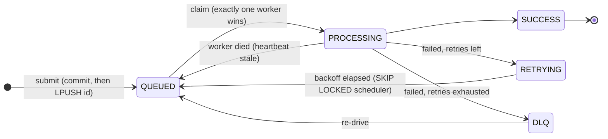
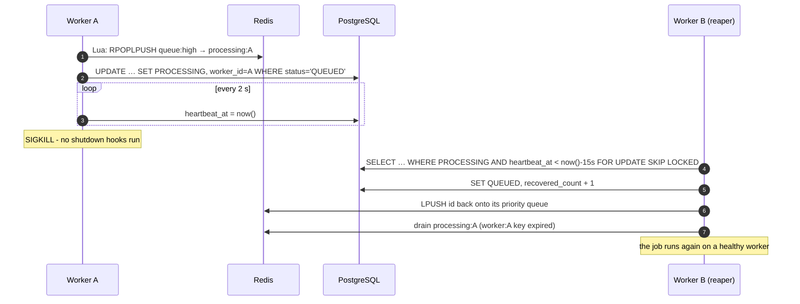
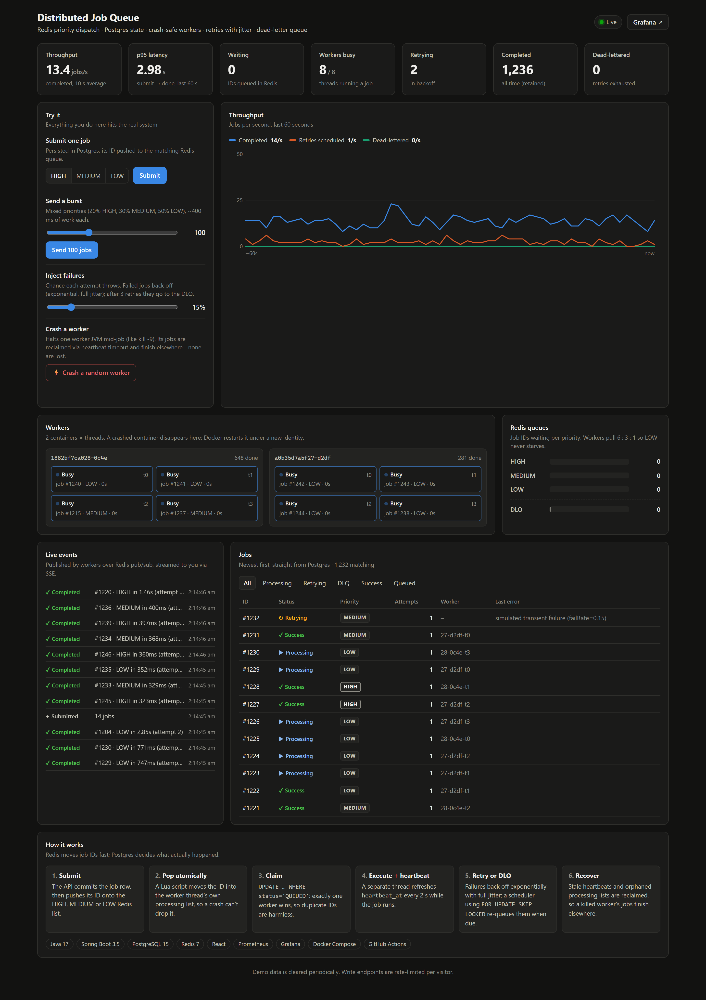
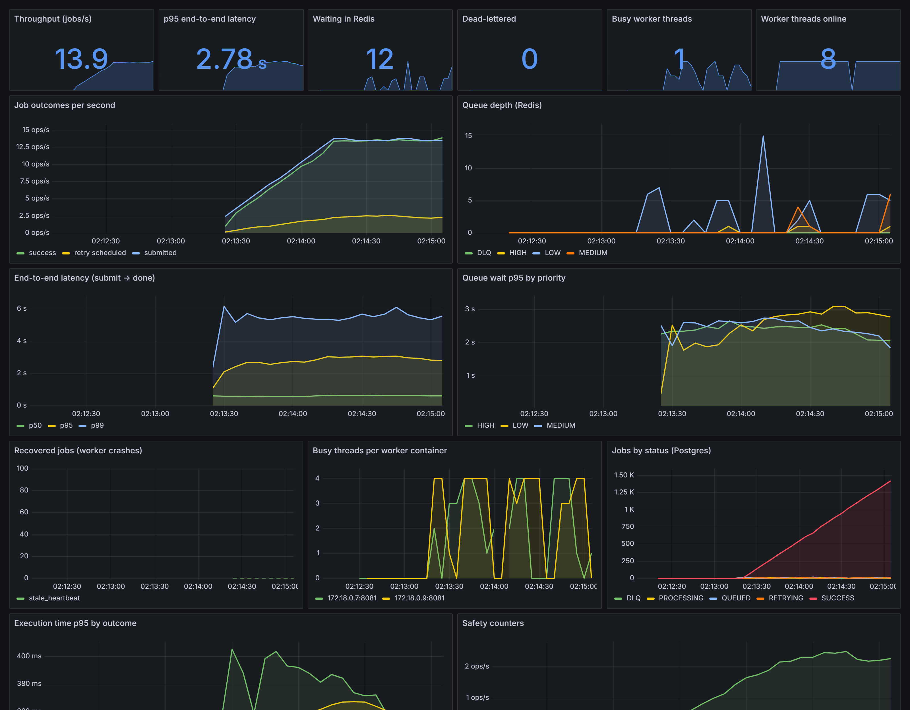

<h1 align="center">Distributed Job Queue</h1>

<p align="center">
  A crash-safe, priority-aware background job system.<br/>
  <b>Redis</b> dispatches · <b>PostgreSQL</b> decides · <b>Spring Boot</b> workers execute · nothing gets lost.
</p>

<p align="center">
  <a href="https://github.com/pratham-ahuja05/distributed-job-queue/actions/workflows/ci.yml"></a>
  
  
  
  
  
</p>

<p align="center">
  
</p>

<p align="center"><i>The <b>Simple view</b>: three lines of waiting tasks, 8 workers picking them up, and a live map of each task's journey. Built so anyone can follow what's happening.</i></p>

---

## Highlights

| | Result | Measured with |
|---|---|---|
| **Fetch latency** | p95 **431.9 ms → 5.1 ms (−98.8%)**, throughput **77×** (33 → 2,504 claims/s) | pgbench · 1M rows · 8 concurrent pollers |
| **Reliability** | permanent failures **30.1% → 1.07% (−96%)** at a 30% transient-failure rate | 3,000 jobs, retries off vs on |
| **Crash safety** | **0 of 4,000 jobs lost** across 4 `SIGKILL`s of busy workers | `scripts/chaos-test.mjs` |
| **Scaling** | 63.8 → 129.7 → 260.9 jobs/s at 4 → 8 → 16 threads (**linear**) | `docker compose --scale worker=N` |
| **Latency** | **p95 162 ms** end-to-end for 50 ms jobs at a steady 100 jobs/s | `scripts/loadtest.mjs --rate 100` |
| **Quality** | 52 tests on real Postgres + Redis, **91% / 96% coverage**, 85% gate in CI | JUnit 5 · Mockito · Testcontainers · JaCoCo |

Raw benchmark output: [`bench/results/`](bench/results).

---

## Architecture

<p align="center">
  
</p>

**The core idea:** Redis is fast but is not the source of truth. It only carries job **IDs**.
Every state change is one conditional `UPDATE` in PostgreSQL, so duplicates, crashes and
races all resolve the same way: *the database decides.*

### Job lifecycle



### What happens when a worker is killed mid-job



### Design decisions

| Problem | Decision |
|---|---|
| Worker dies between pop and claim | **Reliable queue:** a Lua script atomically moves the ID into the thread's own `processing:{id}` list. A reaper drains lists of workers whose liveness key has expired. |
| Two workers grab the same ID | **Conditional claim:** `UPDATE … WHERE status='QUEUED'` matches for exactly one worker, so duplicate IDs are harmless. |
| Worker dies mid-job | **Heartbeats** from a separate thread every 2 s; stale `PROCESSING` rows are reclaimed. |
| Slow worker reclaimed, then finishes late | **Fencing:** results are written only `WHERE worker_id = me AND status = 'PROCESSING'`. |
| Every container runs the schedulers | **`FOR UPDATE SKIP LOCKED`** partitions due rows between them, with no blocking and no double-claims. |
| Retry storms after an outage | **Exponential backoff with full jitter:** `random(0, min(cap, base·2ⁿ))`. |
| LOW jobs starving under HIGH load | **Weighted polling 6 : 3 : 1** with strict-priority fallback, so no capacity is wasted. |
| Committed row never reached Redis | **Orphan sweep** re-pushes old `QUEUED` rows, but only when Redis is empty. |

Delivery is **at-least-once**: a job interrupted by a crash runs again, so handlers should be
idempotent. The chaos test reports these re-executions explicitly.

---

## Quick start

```bash
git clone https://github.com/pratham-ahuja05/distributed-job-queue.git
cd distributed-job-queue
docker compose up -d --build
```

| | |
|---|---|
| Dashboard | http://localhost:3000 |
| Grafana | http://localhost:3000/grafana |
| Prometheus | http://localhost:9090 |

Only Docker is needed: Maven and Node run inside the image builds.

The dashboard opens in the **Simple view**: plain language, no jargon. Switch to **Technical** (top right)
for throughput charts, per-thread worker state, the raw event stream and the jobs table.

<p align="center">
  
</p>

**Things to try on the dashboard:**
- **Send a burst** and watch the queues drain and the workers light up.
- **Inject failures** (e.g. 30%): jobs retry with jittered backoff, and a few end up in the DLQ.
- **Crash a worker:** its container disappears, its jobs are reclaimed about 15 s later, and none are lost.
- **Re-drive** dead-lettered jobs from the Jobs table.

```bash
docker compose up -d --scale worker=4      # 16 worker threads
```

---

## Observability

<p align="center">
  
</p>

Every service exposes Micrometer metrics. Prometheus discovers all worker replicas through DNS,
and a provisioned Grafana dashboard shows throughput, p50/p95/p99 latency, queue wait by priority,
queue depth, busy threads per container, recoveries and safety counters (fenced writes, skipped duplicates).

---

## Benchmarks

Run against the Compose stack on a single laptop (Docker Desktop, Windows 11).

<details>
<summary><b>Job-fetch latency: composite index + <code>SKIP LOCKED</code></b></summary>

The production retry-claim query (10 rows per claim) on a 1M-row table, with 8 concurrent pollers for 30 s each:

| variant | claims/s | p50 | p95 | p99 |
|---|---:|---:|---:|---:|
| no index, `FOR UPDATE` | 32.6 | 209.0 ms | 431.9 ms | 564.9 ms |
| no index, `SKIP LOCKED` | 42.1 | 178.9 ms | 246.4 ms | 373.8 ms |
| composite index, `FOR UPDATE` | 617.6 | 10.0 ms | 32.6 ms | 49.4 ms |
| **composite index, `SKIP LOCKED`** | **2,503.7** | **2.8 ms** | **5.1 ms** | **9.8 ms** |

The index removes the sequential scan; `SKIP LOCKED` removes lock convoys between pollers.
```bash
docker compose cp bench/db/. postgres:/bench/ && docker compose exec -T postgres sh /bench/run.sh
```
</details>

<details>
<summary><b>Retries vs dead-letter rate</b></summary>

3,000 jobs with a 30% chance of transient failure per attempt:

| max retries | succeeded | dead-lettered |
|---:|---:|---:|
| 0 | 2,097 | **30.1%** |
| 3 | 2,968 | **1.07%** (theory: 0.3⁴ = 0.81%) |

```bash
node scripts/loadtest.mjs --count 3000 --duration 20 --failRate 0.3 --maxRetries 3
```
</details>

<details>
<summary><b>Chaos: SIGKILL busy workers under load</b></summary>

4,000 jobs of 150 ms each. Every 20 s the container with the most jobs in flight receives `SIGKILL`:

| kills | jobs in flight when killed | recovered | lost |
|---:|---:|---:|---:|
| 4 | 15 | 16 | **0** |

```bash
node scripts/chaos-test.mjs --count 4000 --duration 150 --kills 4 --every 20
```
</details>

<details>
<summary><b>Horizontal scaling and throughput ceiling</b></summary>

| worker threads | jobs/s (50 ms jobs) |
|---:|---:|
| 4 | 63.8 |
| 8 | 129.7 |
| 16 | 260.9 |

For no-op jobs the cluster peaks at about 500 jobs/s. The bottleneck is PostgreSQL's WAL fsync
(2 commits per job): with `synchronous_commit=off` it reaches 1,216 jobs/s. Durability is kept on
deliberately, because a job queue must not forget an acknowledged state change.
</details>

---

## API

| Method | Endpoint | Description |
|---|---|---|
| `POST` | `/api/jobs` | `{"type":"EMAIL","priority":"HIGH","payload":{…},"maxRetries":3}` |
| `POST` | `/api/jobs/batch` | `{"count":500,"durationMs":50,"failRate":0.3}` (synthetic load) |
| `GET` | `/api/jobs?status=DLQ&page=0&size=25` | list jobs, newest first |
| `GET` | `/api/jobs/{id}` | one job |
| `POST` | `/api/dlq/{id}/redrive` · `/api/dlq/redrive-all` | send dead jobs back with a fresh retry budget |
| `GET` | `/api/stream` | server-sent events, one snapshot per second |
| `GET` | `/api/stats` · `/api/stats/runs/{type}` | live snapshot · per-run percentiles computed in SQL |
| `PUT` | `/api/settings` | `{"failureRate":0.2}` (demo fault injection) |
| `POST` | `/api/chaos/crash-worker` | halt one worker JVM (demo) |

---

## Project structure

```
api-service/        REST API, SSE live stats, Flyway schema (V1__create_jobs.sql)
worker-service/     worker pool, Lua pop, claim/fencing, heartbeat, retry scheduler, recovery
dashboard/          React + TypeScript (Vite) UI, served by nginx which also proxies /api and /grafana
ops/                Prometheus config, Grafana datasource + dashboard provisioning
bench/              pgbench claim-latency benchmark + recorded results
scripts/            loadtest.mjs, chaos-test.mjs (no dependencies, Node 18+)
.github/workflows/  CI: tests + coverage gate, dashboard build, image build
```

## Development

```bash
cd api-service    && ./mvnw verify     # Docker must be running (Testcontainers)
cd worker-service && ./mvnw verify
cd dashboard      && npm install && npm run dev    # http://localhost:5173, proxies to :3000
```

## Deployment

The whole stack fits in about 1.5 GB of RAM on a single small VM. See [DEPLOY.md](DEPLOY.md) for the
production overrides (rate limiting, backlog cap, data retention, single public port).

---

**Stack:** Java 17 · Spring Boot 3.5 · Spring Data JPA / JDBC · PostgreSQL 15 · Redis 7 · Flyway ·
Micrometer · Prometheus · Grafana · React + TypeScript · nginx · Docker Compose · GitHub Actions ·
JUnit 5 · Mockito · Testcontainers · JaCoCo
